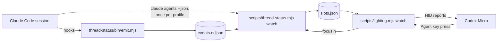
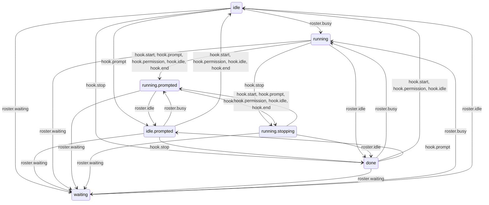
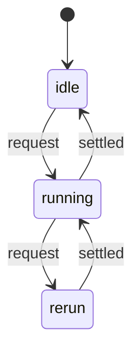
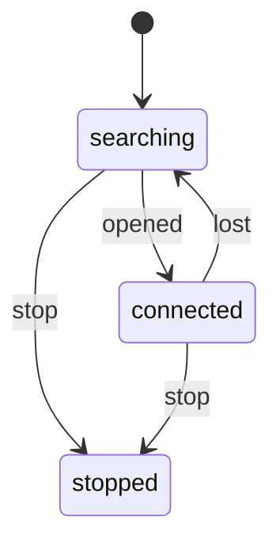

[English](architecture.md) · [Français](fr/architecture.md)

# Architecture of the Agent keys

How a Claude Code session ends up as a colour on one of the six Agent keys, and
where each decision is made. The measurements behind these choices are in
[`research/thread-status-feasibility.md`](research/thread-status-feasibility.md);
this page describes the code as it stands.

## The pipeline



Two processes, kept apart on purpose. The companion needs only `claude`; the
lighting bridge needs the keyboard. `slots.json` is the seam between them: a pad
that is unplugged does not stop the session state from being kept up to date,
and the companion never opens the device.

Nothing here writes to the keyboard's storage. The bridge sends volatile HID
reports only.

## Where each thing lives

| Module | Role | Side effects |
| --- | --- | --- |
| `scripts/lib/state-machine.mjs` | Table-driven finite state machine: validation, lookup, graph walk, diagram | none |
| `scripts/lib/session-machine.mjs` | Lifecycle of one session: 16 phases, 12 events | none |
| `scripts/lib/thread-slots.mjs` | Six slots: which session holds which key, eviction, navigation target | none |
| `scripts/lib/config-dirs.mjs` | Which Claude profiles to ask, and how their rosters merge | none |
| `scripts/lib/reconcile.mjs` | One pass: rosters first, then the hooks of that pass | none |
| `scripts/lib/run-loop.mjs` | One pass at a time, no request lost | timers |
| `scripts/lib/device-link.mjs` | Opens the keyboard, and reopens it when it is lost | timers |
| `scripts/lib/slot-store.mjs` | Reads the hook journal, writes `slots.json` only when a key changed | files in the state directory |
| `scripts/lib/roster-source.mjs` | Runs `claude agents --json` and `ps` | child processes |
| `scripts/lib/terminals.mjs` | Recognises the terminal hosting a session, focuses its tab | `osascript` |
| `scripts/lib/claude-binary.mjs` | Finds the `claude` binary | reads `PATH` |
| `scripts/lib/state-paths.mjs` | The state directory and its two files | none |
| `scripts/thread-status.mjs` | Companion CLI: `watch`, `status`, `focus`, `doctor` | wires the above |
| `scripts/lighting.mjs` | Lighting bridge CLI | HID device |
| `scripts/lib/launch-agent.mjs`, `scripts/service.mjs` | launchd agents for the two watchers | `~/Library/LaunchAgents` |

The modules with no side effect hold every decision, and are tested without a
running Claude or a keyboard. The others are thin: they fetch or deliver.

## State machines

State that lives in a few flags and the conditionals around them cannot be
enumerated, so nobody can say what happens on an event the author did not think
about. Before 12 November 2026 the slot reducer kept four fields per session
(`state`, `lastHookState`, `blockingNotification`, `rosterStatus`); walking
every reachable combination showed 33 distinguishable states that no line of
code named.

A machine built with `defineMachine` is a table. Every state lists the events
that move it, anything unlisted leaves it where it is, and a table that names an
undeclared state or event is refused when it is defined. Because it is a table,
tests can check properties over all of it instead of on chosen paths.

### The session machine

Two sources report on a session. The roster (`claude agents --json`) is polled
and, since Claude Code 2.1.322, publishes `busy`, `idle` or `waiting`. The
plugin's hooks fire on events and know what the roster does not: that a turn
finished rather than got interrupted, that an agent is asking a question.

The phases are in two families:

- **tracked** — the roster publishes a status. It decides between working,
  waiting and idle; hooks refine and never contradict it;
- **hooks only** (`hooks.*`) — the roster lists the session without a status: an
  older Claude Code, or a roster read that failed. Hooks alone decide.

The rules the table encodes:

- **A key never contradicts an explicit status.** A hook leads or trails the
  roster by up to 258 ms. `idle.prompted` and `running.stopping` hold a prompt
  or a `Stop` the roster has not caught up with, without changing the key.
- **The end of a turn reads by who saw it begin.** From `running`, seen by the
  roster only, `idle` means a finished turn. From `running.prompted`, a hook
  vouches that hooks are installed, so `idle` with no `Stop` is an interrupted
  turn. From `running.stopping`, `idle` confirms the `Stop`.
- **Red has two origins.** `waiting` is lit and cleared by the roster alone,
  since answering a permission prompt fires no hook. `asked.*` comes from the
  `agent_needs_input` and `elicitation_dialog` hooks, whose roster status is not
  measured: the roster's `busy` and `idle` do not clear it.
- **`ended` is the roster's to decide.** Hooks are ignored there.

The everyday path — a status is published and no agent is asking a question:



The whole table follows: one row per phase, one column per event, and `·` where
the phase stays as it is. First the roster events:

| phase | shows | `busy` | `idle` | `waiting` | `silent` | `gone` |
| --- | --- | --- | --- | --- | --- | --- |
| `idle` | idle | `running` | · | `waiting` | `hooks.idle` | `ended` |
| `idle.prompted` | idle | `running.prompted` | · | `waiting` | `hooks.idle` | `ended` |
| `running` | running | · | `done` | `waiting` | `hooks.observed` | `ended` |
| `running.prompted` | running | · | `idle.prompted` | `waiting` | `hooks.running` | `ended` |
| `running.stopping` | running | · | `done` | `waiting` | `hooks.observed` | `ended` |
| `waiting` | blocked | `running` | `idle` | · | `hooks.waiting` | `ended` |
| `asked.busy` | blocked | · | `asked.idle` | `waiting` | `hooks.asked` | `ended` |
| `asked.idle` | blocked | `asked.busy` | · | `waiting` | `hooks.asked` | `ended` |
| `done` | done | `running` | · | `waiting` | `hooks.done` | `ended` |
| `hooks.idle` | idle | `running` | `idle` | `waiting` | · | `ended` |
| `hooks.running` | running | `running.prompted` | `idle.prompted` | `waiting` | · | `ended` |
| `hooks.observed` | running | `running` | `done` | `waiting` | · | `ended` |
| `hooks.waiting` | blocked | `running` | `idle` | `waiting` | · | `ended` |
| `hooks.asked` | blocked | `asked.busy` | `asked.idle` | `waiting` | · | `ended` |
| `hooks.done` | done | `running` | `done` | `waiting` | · | `ended` |
| `ended` | ended | `running` | `idle` | `waiting` | `hooks.idle` | · |

Then the hook events:

| phase | shows | `start` | `prompt` | `stop` | `permission` | `ask` | `idle` | `end` |
| --- | --- | --- | --- | --- | --- | --- | --- | --- |
| `idle` | idle | · | `idle.prompted` | `done` | · | `asked.idle` | · | · |
| `idle.prompted` | idle | `idle` | · | `done` | `idle` | `asked.idle` | `idle` | `idle` |
| `running` | running | `running.prompted` | `running.prompted` | `running.stopping` | `running.prompted` | `asked.busy` | `running.prompted` | `running.prompted` |
| `running.prompted` | running | · | · | `running.stopping` | · | `asked.busy` | · | · |
| `running.stopping` | running | `running.prompted` | `running.prompted` | · | `running.prompted` | `asked.busy` | `running.prompted` | `running.prompted` |
| `waiting` | blocked | · | · | · | · | · | · | · |
| `asked.busy` | blocked | `running.prompted` | `running.prompted` | `running.stopping` | `running.prompted` | · | `running.prompted` | `running.prompted` |
| `asked.idle` | blocked | `idle` | `idle.prompted` | `done` | `idle` | · | `idle` | `idle` |
| `done` | done | `idle` | `idle.prompted` | · | `idle` | `asked.idle` | `idle` | · |
| `hooks.idle` | idle | · | `hooks.running` | `hooks.done` | `hooks.waiting` | `hooks.asked` | · | `ended` |
| `hooks.running` | running | `hooks.idle` | · | `hooks.done` | `hooks.waiting` | `hooks.asked` | `hooks.idle` | `ended` |
| `hooks.observed` | running | `hooks.idle` | `hooks.running` | `hooks.done` | `hooks.waiting` | `hooks.asked` | `hooks.idle` | `ended` |
| `hooks.waiting` | blocked | `hooks.idle` | `hooks.running` | `hooks.done` | · | `hooks.asked` | `hooks.idle` | `ended` |
| `hooks.asked` | blocked | `hooks.idle` | `hooks.running` | `hooks.done` | `hooks.waiting` | · | `hooks.idle` | `ended` |
| `hooks.done` | done | `hooks.idle` | `hooks.running` | · | `hooks.waiting` | `hooks.asked` | `hooks.idle` | `ended` |
| `ended` | ended | · | · | · | · | · | · | · |

Hook records map to events as follows: `SessionStart` → `start`,
`UserPromptSubmit` → `prompt`, `Stop` → `stop`, `SessionEnd` → `end`, and the
`Notification` types `permission_prompt` → `permission`, `agent_needs_input` and
`elicitation_dialog` → `ask`, `idle_prompt` → `idle`. Any other record is not an
event.

### What changed when the machine replaced the flags

The old and the new reducer were walked in lockstep over every event sequence
for one session, on 12 November 2026: 71 joint configurations, with these
differences, all deliberate:

- a hook that arrives after the roster dropped the session no longer changes its
  key. The journal is read after the roster, so a `Stop` written just before the
  process exited turned a closed session green until the next poll;
- `SessionEnd` on a finished turn no longer shows `idle` for the one poll before
  the roster drops the session;
- what a closed session knew from hooks does not survive it: a session that
  comes back is read from the roster.

The real recordings under `tests/fixtures/thread-status` replay with no
disagreement, as before.

### The run loop

Both watchers are woken by a timer and by a file change, while a pass is
asynchronous. A boolean guard dropped the request made during a pass, so a hook
written while the roster was being read waited for the next poll.



A request during a pass leads to exactly one more pass, however many times it
was made.

### The device link

The keyboard comes and goes: unplugged, switched to Bluetooth, asleep. On
12 November 2026 it left USB while the bridge ran as a launchd agent. The bridge
logged the same failed write 1,746 times on a dead handle and did not exit, so
launchd did not restart it: plugging the keyboard back in would have changed
nothing.



A write that fails because the handle is dead moves the link back to
`searching`, where it tries to open the keyboard every three seconds and says so
once. On `connected` the bridge sends the colours again, since the keyboard does
not keep them. A late or refused answer is not a loss.

## Keeping this page true

The state diagrams and the two tables above are generated from the code:

```sh
node scripts/machine-docs.mjs session-diagram
node scripts/machine-docs.mjs session-roster-table
node scripts/machine-docs.mjs session-hook-table
node scripts/machine-docs.mjs run-loop-diagram
node scripts/machine-docs.mjs device-link-diagram
```

`tests/architecture-docs.test.mjs` fails when either language of this page no
longer matches that output.
