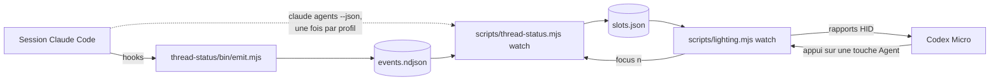
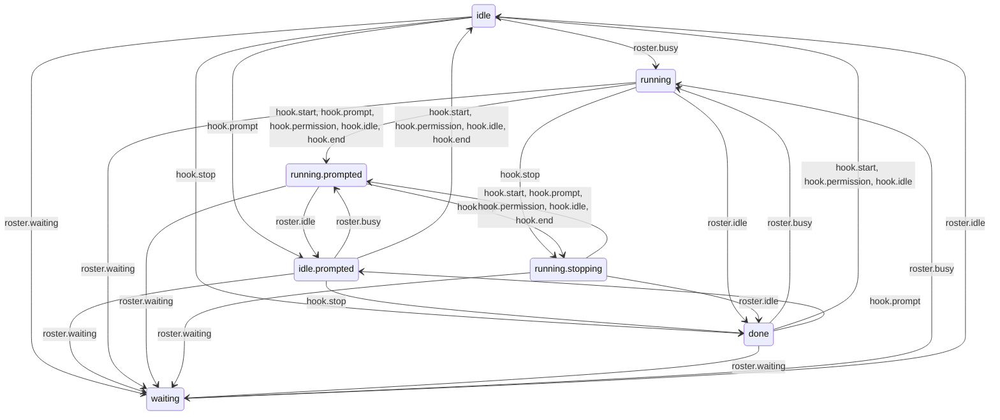
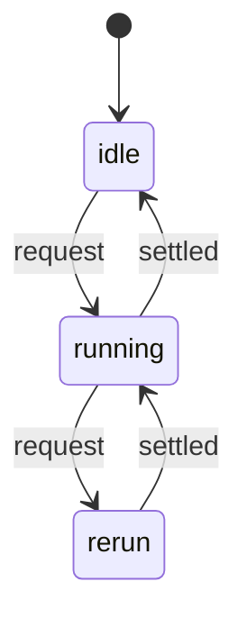
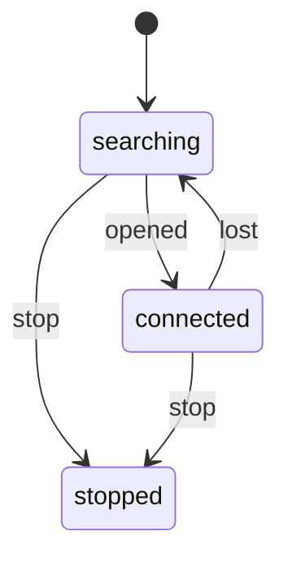

[English](../architecture.md) · [Français](architecture.md)

# Architecture des touches Agent

Comment une session Claude Code devient une couleur sur l'une des six touches
Agent, et où chaque décision est prise. Les mesures qui fondent ces choix sont
dans [`research/thread-status-feasibility.md`](research/thread-status-feasibility.md) ;
cette page décrit le code tel qu'il est.

## La chaîne



Deux processus, séparés volontairement. Le compagnon n'a besoin que de
`claude` ; le pont d'éclairage a besoin du clavier. `slots.json` est la jointure
entre les deux : un clavier débranché n'empêche pas l'état des sessions d'être
tenu à jour, et le compagnon n'ouvre jamais le périphérique.

Rien ici n'écrit dans le stockage du clavier. Le pont n'envoie que des rapports
HID volatils.

## Où se trouve chaque chose

| Module | Rôle | Effets de bord |
| --- | --- | --- |
| `scripts/lib/state-machine.mjs` | Machine à états finie pilotée par une table : validation, consultation, parcours du graphe, diagramme | aucun |
| `scripts/lib/session-machine.mjs` | Cycle de vie d'une session : 16 phases, 12 événements | aucun |
| `scripts/lib/thread-slots.mjs` | Six emplacements : quelle session tient quelle touche, éviction, cible de navigation | aucun |
| `scripts/lib/config-dirs.mjs` | Quels profils Claude interroger, et comment fusionner leurs listes | aucun |
| `scripts/lib/reconcile.mjs` | Une passe : les listes d'abord, puis les hooks de cette passe | aucun |
| `scripts/lib/run-loop.mjs` | Une passe à la fois, aucune demande perdue | minuteries |
| `scripts/lib/device-link.mjs` | Ouvre le clavier, et le rouvre quand il est perdu | minuteries |
| `scripts/lib/slot-store.mjs` | Lit le journal des hooks, n'écrit `slots.json` que si une touche a changé | fichiers du dossier d'état |
| `scripts/lib/roster-source.mjs` | Lance `claude agents --json` et `ps` | processus enfants |
| `scripts/lib/terminals.mjs` | Reconnaît le terminal qui héberge une session, met son onglet au premier plan | `osascript` |
| `scripts/lib/claude-binary.mjs` | Trouve le binaire `claude` | lit le `PATH` |
| `scripts/lib/state-paths.mjs` | Le dossier d'état et ses deux fichiers | aucun |
| `scripts/thread-status.mjs` | CLI du compagnon : `watch`, `status`, `focus`, `doctor` | relie ce qui précède |
| `scripts/lighting.mjs` | CLI du pont d'éclairage | périphérique HID |
| `scripts/lib/launch-agent.mjs`, `scripts/service.mjs` | Agents launchd des deux observateurs | `~/Library/LaunchAgents` |

Les modules sans effet de bord portent toutes les décisions et sont testés sans
Claude ni clavier. Les autres sont minces : ils vont chercher ou ils livrent.

## Machines à états

Un état réparti entre quelques drapeaux et les conditions qui les entourent ne
peut pas être énuméré : personne ne peut dire ce qui se passe sur un événement
auquel l'auteur n'a pas pensé. Avant le 12 novembre 2026, le réducteur gardait
quatre champs par session (`state`, `lastHookState`, `blockingNotification`,
`rosterStatus`) ; le parcours de toutes les combinaisons atteignables a montré
33 états distinguables qu'aucune ligne de code ne nommait.

Une machine construite avec `defineMachine` est une table. Chaque état liste les
événements qui le font bouger, tout événement non listé le laisse en place, et
une table qui nomme un état ou un événement non déclaré est refusée à sa
définition. Parce que c'est une table, les tests vérifient des propriétés sur
l'ensemble, et non sur des chemins choisis.

### La machine de session

Deux sources renseignent sur une session. La liste (`claude agents --json`) est
interrogée périodiquement et, depuis Claude Code 2.1.322, publie `busy`, `idle`
ou `waiting`. Les hooks du plugin se déclenchent sur événement et savent ce que
la liste ignore : qu'un tour s'est terminé plutôt qu'interrompu, qu'un agent
pose une question.

Les phases forment deux familles :

- **suivie** — la liste publie un statut. Elle tranche entre travail, attente et
  repos ; les hooks affinent et ne la contredisent jamais ;
- **hooks seuls** (`hooks.*`) — la liste mentionne la session sans statut : un
  Claude Code plus ancien, ou une lecture de la liste qui a échoué. Les hooks
  décident seuls.

Les règles que la table encode :

- **Une touche ne contredit jamais un statut explicite.** Un hook devance ou
  suit la liste de 258 ms au plus. `idle.prompted` et `running.stopping`
  retiennent un prompt ou un `Stop` que la liste n'a pas encore rattrapé, sans
  changer la touche.
- **La fin d'un tour se lit selon qui l'a vu commencer.** Depuis `running`, vu
  par la liste seule, `idle` signifie un tour terminé. Depuis
  `running.prompted`, un hook atteste que les hooks sont installés : `idle` sans
  `Stop` est donc un tour interrompu. Depuis `running.stopping`, `idle` confirme
  le `Stop`.
- **Le rouge a deux origines.** `waiting` est allumé et éteint par la liste
  seule, car répondre à une demande de permission ne déclenche aucun hook.
  `asked.*` vient des hooks `agent_needs_input` et `elicitation_dialog`, dont le
  statut dans la liste n'est pas mesuré : les `busy` et `idle` de la liste ne
  l'éteignent pas.
- **`ended` appartient à la liste.** Les hooks y sont ignorés.

Le chemin de tous les jours — un statut est publié et aucun agent ne pose de
question :



La table complète suit : une ligne par phase, une colonne par événement, et `·`
là où la phase reste telle quelle. D'abord les événements de la liste :

| phase | shows | `busy` | `idle` | `waiting` | `silent` | `gone` |
| --- | --- | --- | --- | --- | --- | --- |
| `idle` | idle | `running` | · | `waiting` | `hooks.idle` | `ended` |
| `idle.prompted` | idle | `running.prompted` | · | `waiting` | `hooks.idle` | `ended` |
| `running` | running | · | `done` | `waiting` | `hooks.observed` | `ended` |
| `running.prompted` | running | · | `idle.prompted` | `waiting` | `hooks.running` | `ended` |
| `running.stopping` | running | · | `done` | `waiting` | `hooks.observed` | `ended` |
| `waiting` | blocked | `running` | `idle` | · | `hooks.waiting` | `ended` |
| `asked.busy` | blocked | · | `asked.idle` | `waiting` | `hooks.asked` | `ended` |
| `asked.idle` | blocked | `asked.busy` | · | `waiting` | `hooks.asked` | `ended` |
| `done` | done | `running` | · | `waiting` | `hooks.done` | `ended` |
| `hooks.idle` | idle | `running` | `idle` | `waiting` | · | `ended` |
| `hooks.running` | running | `running.prompted` | `idle.prompted` | `waiting` | · | `ended` |
| `hooks.observed` | running | `running` | `done` | `waiting` | · | `ended` |
| `hooks.waiting` | blocked | `running` | `idle` | `waiting` | · | `ended` |
| `hooks.asked` | blocked | `asked.busy` | `asked.idle` | `waiting` | · | `ended` |
| `hooks.done` | done | `running` | `done` | `waiting` | · | `ended` |
| `ended` | ended | `running` | `idle` | `waiting` | `hooks.idle` | · |

Puis les événements des hooks :

| phase | shows | `start` | `prompt` | `stop` | `permission` | `ask` | `idle` | `end` |
| --- | --- | --- | --- | --- | --- | --- | --- | --- |
| `idle` | idle | · | `idle.prompted` | `done` | · | `asked.idle` | · | · |
| `idle.prompted` | idle | `idle` | · | `done` | `idle` | `asked.idle` | `idle` | `idle` |
| `running` | running | `running.prompted` | `running.prompted` | `running.stopping` | `running.prompted` | `asked.busy` | `running.prompted` | `running.prompted` |
| `running.prompted` | running | · | · | `running.stopping` | · | `asked.busy` | · | · |
| `running.stopping` | running | `running.prompted` | `running.prompted` | · | `running.prompted` | `asked.busy` | `running.prompted` | `running.prompted` |
| `waiting` | blocked | · | · | · | · | · | · | · |
| `asked.busy` | blocked | `running.prompted` | `running.prompted` | `running.stopping` | `running.prompted` | · | `running.prompted` | `running.prompted` |
| `asked.idle` | blocked | `idle` | `idle.prompted` | `done` | `idle` | · | `idle` | `idle` |
| `done` | done | `idle` | `idle.prompted` | · | `idle` | `asked.idle` | `idle` | · |
| `hooks.idle` | idle | · | `hooks.running` | `hooks.done` | `hooks.waiting` | `hooks.asked` | · | `ended` |
| `hooks.running` | running | `hooks.idle` | · | `hooks.done` | `hooks.waiting` | `hooks.asked` | `hooks.idle` | `ended` |
| `hooks.observed` | running | `hooks.idle` | `hooks.running` | `hooks.done` | `hooks.waiting` | `hooks.asked` | `hooks.idle` | `ended` |
| `hooks.waiting` | blocked | `hooks.idle` | `hooks.running` | `hooks.done` | · | `hooks.asked` | `hooks.idle` | `ended` |
| `hooks.asked` | blocked | `hooks.idle` | `hooks.running` | `hooks.done` | `hooks.waiting` | · | `hooks.idle` | `ended` |
| `hooks.done` | done | `hooks.idle` | `hooks.running` | · | `hooks.waiting` | `hooks.asked` | `hooks.idle` | `ended` |
| `ended` | ended | · | · | · | · | · | · | · |

Les enregistrements de hooks correspondent aux événements ainsi :
`SessionStart` → `start`, `UserPromptSubmit` → `prompt`, `Stop` → `stop`,
`SessionEnd` → `end`, et les types de `Notification` `permission_prompt` →
`permission`, `agent_needs_input` et `elicitation_dialog` → `ask`,
`idle_prompt` → `idle`. Tout autre enregistrement n'est pas un événement.

### Ce qui a changé quand la machine a remplacé les drapeaux

L'ancien et le nouveau réducteur ont été parcourus en parallèle sur toutes les
séquences d'événements d'une session, le 12 novembre 2026 : 71 configurations
jointes, avec ces différences, toutes voulues :

- un hook qui arrive après que la liste a retiré la session ne change plus sa
  touche. Le journal est lu après la liste : un `Stop` écrit juste avant la fin
  du processus repassait une session fermée au vert jusqu'au sondage suivant ;
- `SessionEnd` sur un tour terminé n'affiche plus `idle` pendant le sondage qui
  précède le retrait de la session ;
- ce qu'une session fermée savait par les hooks ne lui survit pas : une session
  qui revient est lue depuis la liste.

Les enregistrements réels de `tests/fixtures/thread-status` se rejouent sans
désaccord, comme avant.

### La boucle d'exécution

Les deux observateurs sont réveillés par une minuterie et par un changement de
fichier, alors qu'une passe est asynchrone. Un garde booléen abandonnait la
demande faite pendant une passe : un hook écrit pendant la lecture de la liste
attendait le sondage suivant.



Une demande faite pendant une passe entraîne exactement une passe de plus, quel
que soit le nombre de fois où elle a été faite.

### La liaison au clavier

Le clavier va et vient : débranché, passé en Bluetooth, en veille. Le
12 novembre 2026, il a quitté l'USB pendant que le pont tournait en agent
launchd. Le pont a journalisé 1 746 fois la même écriture en échec sur un
descripteur mort, sans s'arrêter : launchd ne l'a donc pas relancé, et
rebrancher le clavier n'aurait rien changé.



Une écriture qui échoue parce que le descripteur est mort ramène la liaison à
`searching`, où elle tente d'ouvrir le clavier toutes les trois secondes et le
signale une seule fois. À `connected`, le pont renvoie les couleurs, car le
clavier ne les conserve pas. Une réponse tardive ou refusée n'est pas une perte.

## Garder cette page exacte

Les diagrammes d'états et les deux tables ci-dessus sont générés depuis le code :

```sh
node scripts/machine-docs.mjs session-diagram
node scripts/machine-docs.mjs session-roster-table
node scripts/machine-docs.mjs session-hook-table
node scripts/machine-docs.mjs run-loop-diagram
node scripts/machine-docs.mjs device-link-diagram
```

`tests/architecture-docs.test.mjs` échoue dès que l'une des deux langues de
cette page ne correspond plus à cette sortie.
